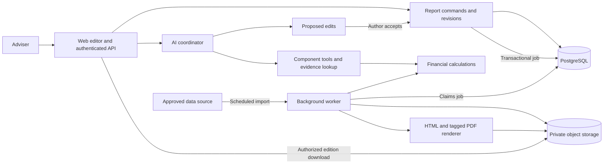

# ETF research and report editor

**MVP architecture · 26 November 2026 · Implementation proposal**

Build a modular monolith with an interactive web process and a background worker. The adviser’s unit of work is a saved report. The reader receives a dated edition as accessible HTML or PDF. The first useful demonstration is updating an existing comparison for a second client meeting and tracing a changed sentence back to the holdings that justify it.

**Pilot assumptions.** One author per report, private workspaces, two USD-denominated long-only equity ETFs per comparison, and one approved data source per data type. Support several instances of any component. Use synthetic fixtures until the team verifies rights for ingestion, storage, model processing and distribution in each output. Public GitHub visibility governs source code only. Keep credentials, licensed data, reports and client content outside the repository.

## Runtime boundaries

Start the web app with the Next.js App Router TypeScript starter. Share the domain types, validators and calculations between web and worker. Use PostgreSQL for report transactions and a durable jobs table. Use private object storage for licensed source files and edition artifacts. Trial WeasyPrint in a locked-down worker process for tagged PDF generation. Pin exact dependencies and fonts in the implementation lockfiles and container image after the export prototype passes. [Next.js installation](https://nextjs.org/docs/app/getting-started/installation) · [PostgreSQL release support](https://www.postgresql.org/support/versioning/) · [WeasyPrint PDF variants](https://doc.courtbouillon.org/weasyprint/stable/common_use_cases.html)

## Data ownership

| Owner | Stored records | Contract consumed elsewhere |
|---|---|---|
| Identity | Workspace, member, authenticated session | Server resolves workspace and role on each request and job. An author may edit their reports. A reader may view explicitly shared editions. |
| Market data | Fund, security identity mapping, source file, immutable dataset snapshot, dated holdings or return observations | Each snapshot carries fund, source, as-of date, currency, coverage, retrieval time, checksum and usage rights. Corrections receive new snapshot IDs. |
| Analytics | Versioned calculation and immutable result | A result carries input snapshot IDs, parameters, method version, units, unrounded values, coverage warnings and source references. |
| Reports | Report, ordered component instances, draft revision, command history, proposals | Each instance has an immutable ID, type and schema version, settings, result reference and editable copy. Commentary records author and referenced result IDs. |
| Publishing | Edition, layout, theme, assets, render job | An edition freezes report content, evidence, template, fonts and renderer version. Store the final HTML and PDF with checksums. |

### AD-1 · Every edit targets a revision and a component instance

**Binds** editor, AI, persistence and undo. **Prevents** two growth charts sharing accidental state. **Rule** route all edits through one command handler. A request carries report ID, expected revision, request ID, operation and explicit target IDs. Add, duplicate, configure, reorder, annotate and theme are typed operations. Duplicate assigns a fresh ID and copies settings and captions. Equal inputs may reuse an immutable result.

The server checks membership, validates the proposed change and commits all operations together with a new revision. Replaying the same request returns the original outcome. Reusing a request ID with different contents fails. A stale revision returns a conflict with a fresh preview. Undo creates a new revision. Selecting chart B binds “make this three years” to B. An ambiguous request offers a title picker. A report-wide request previews the affected instances.

### AD-2 · Compute and cite the evidence once

**Binds** imports, financial tools, charts and text. **Prevents** different answers in the chart, caption and PDF. **Rule** only the analytics module computes financial measures. Keep decimal precision through calculation and round in presentation.

| Component | Calculation and boundary cases |
|---|---|
| Growth | Use comparable same-currency total-return indices with the same basis and dividend treatment. At common observation dates, value equals starting investment × current index / starting index. Show actual common start and end, currency and basis. Flag gaps, omit unavailable points, and request a shorter range when history is insufficient. |
| Top holdings | Aggregate duplicate positions using the normalized security ID within a snapshot, rank by portfolio weight, show date, percent of total portfolio and disclosed coverage. Record cash separately. Preserve distinct share classes. |
| Overlap | For same-date snapshots, sum the lesser portfolio weight of each matched eligible security. Use full-portfolio weights and show top contributors. Identify excluded cash and unmatched positions. Partial disclosures yield an explicitly labeled observed overlap. With incompatible dates, offer the latest common snapshot or show the measure as unavailable. |

Reference fixture: fund A holds X at 60% and Y at 40%. Fund B holds X at 25% and Z at 75%. Full-security overlap is 25%, entirely attributable to X. A second growth chart using the same ETFs and a different start date must produce an independent series.

### AD-3 · AI proposes bounded operations

**Binds** coordinator, specialists and editor. **Prevents** unsupported claims and invisible edits. **Rule** one coordinator resolves intent and delegates typed tasks to component tools. Growth, holdings and overlap own domain-specific settings and explanations. The summary tool receives reviewed findings and their evidence IDs. The design tool receives approved theme tokens, font families and layout options. The data service performs provider access under server credentials.

Tools return structured changes, evidence references, caveats or a clarification request. The server verifies target ownership, allowed operations, evidence membership and numeric references. Render financial numbers in generated copy from referenced result fields. Show qualitative interpretations as drafts for author review. Treat source text as untrusted data. Send the model only the evidence needed and permitted for this operation. Bound calls, time and spend per request. On timeout retain the draft and expose manual controls. Add independent specialist model calls only if evaluation shows better outcomes than a typed tool with the same inputs.

### AD-4 · Refresh creates a reviewable difference

**Binds** ingestion, editorial workflow and publishing. **Prevents** silent restatement of an issued report. **Rule** refreshing a draft pins candidate snapshots and calculates new component results. Present old and new values, dates, changed coverage, and the captions and summaries referencing those results. Preserve evidence links when a user edits generated copy. Flag affected passages and any unlinked manual commentary for review on refresh, since a manually typed figure may also have changed. Author acceptance creates a revision. Require review of flagged commentary before publication. A failed refresh keeps the previous revision usable.

### AD-5 · Publish one edition through two accessible layouts

**Binds** design, editor and export. **Prevents** disagreement between web and print and inaccessible chart-only output. **Rule** render from one semantic document model with a heading hierarchy, chart takeaway, equivalent data table, period, units and source links. Use keyboard-operable add, move and edit controls, visible focus, announced job status and non-color encodings. Target WCAG 2.2 AA for web and tagged PDF/UA-1 for PDF. Set document title and language. Run automated PDF/UA checks on every export. Repeat manual screen-reader checks on representative fixtures whenever templates, fonts or the renderer change. Verify actual exported reading order, table headers, link labels, document language and text alternatives. [WCAG 2.2](https://www.w3.org/TR/WCAG22/) · [W3C PDF techniques](https://www.w3.org/WAI/WCAG22/Techniques/)

Factsheet layout permits a curated subset of rows and observations with clearly labeled summaries. Full-report layout includes detail tables and sources. If the factsheet overflows one page, preview the overflow and offer a smaller selection or the multipage layout. Preserve legibility. Each edition pins one layout and template version. Publishing both layouts creates two editions of the same revision. Key publication requests by workspace, report, revision, layout, template and theme versions. Each request queues HTML and PDF for that edition. Expose an edition as ready only after both artifacts pass release checks. Keep failed jobs retryable. Serve archived artifacts for prior editions.

## Screens and service operations

The report library opens a saved draft or creates a comparison. The editor contains a component outline, reading-order preview, evidence inspector and assistant panel. Preview offers factsheet and full-report layouts. The edition screen shows publication date, source dates and downloads. Private delivery uses authenticated access or an author-generated expiring, revocable link to one edition.

| Operation | Representative endpoint | Observable result |
|---|---|---|
| Create or read draft | POST /reports or GET /reports/:id | Authorized draft with revision and component IDs |
| Ask and preview | POST /reports/:id/proposals | Scoped component changes, evidence and affected captions |
| Apply or undo | POST /reports/:id/commands | New revision or explicit conflict |
| Refresh evidence | POST /reports/:id/refresh | Job ID, then a dated comparison for review |
| Publish edition | POST /reports/:id/editions | Idempotent edition ID and render status |
| Read edition | GET /editions/:id | Frozen web report and authorized PDF download |

## Deployment and recovery

Deploy web and worker separately from one repository in a single region, with separate development, staging and production credentials and stores. Use managed identity, secure session cookies, server-side authorization on resource IDs, and signed short-lived downloads. Restrict import network access to approved sources. Render trusted templates with bundled assets and disable arbitrary network and local-file access in the renderer. Enforce data rights at export and share time.

Record job creation with the relevant database transaction. Workers claim expiring leases, retry transient failures with backoff, and write artifacts under edition-specific keys. A uniqueness constraint on job type, edition and rendition prevents duplicate publication. Observe import freshness, coverage warnings, failed renders, queue age, model cost and edit conflicts. Log identifiers and timings with an audit trail of imports, accepted edits, sharing and publishing. Keep report text and credentials out of operational logs. Back up the database and objects, then restore a sample edition in staging before admitting pilot users.

## Build order and exit criteria

| Milestone | Demonstration required before moving on |
|---|---|
| 1. Accessible overlap factsheet | Import the known fixture, reproduce 25%, and publish matching HTML and tagged PDF. A keyboard and screen-reader user can locate the value, contributor and source. Check the exported file with a PDF accessibility validator and a screen reader. |
| 2. Manual research editor | Add growth and holdings, duplicate a growth chart, change only the duplicate, undo, and reopen the saved report. Exercise partial data, stale writes, workspace isolation, one-page overflow and full-report export. |
| 3. Evidence-linked assistant | Reproduce manual edits through natural language. Test ambiguous references, unsupported explanations, model failure and proposed edits to another workspace. Compare time and correction rate against the manual workflow. |
| 4. Quarterly refresh pilot | Import new and corrected snapshots, review a changed caption and a manually typed figure, and publish edition two. Verify edition one still downloads with its original checksum. Interrupt and retry an export, revoke a share link and restore a backup. |

**Pilot dependencies.** Validate both funds’ holdings history, identifiers, comparable return series and rights before selecting the provider. Run the export proof with the intended fonts, a dense table and assistive technology before committing to the PDF engine. Select model and hosting providers after measuring cost and latency with the scripted comparison task and confirming permitted data handling. Real-time coediting, arbitrary report-layout code, multicurrency comparisons and independent agent services can wait until observed user demand justifies their cost.

## Editor and report colors

Use the project’s [semantic color tokens](../../design/colors.css) for a Codex-inspired neutral palette. Give the main action the primary fill and its paired foreground. Give secondary actions the secondary pair. Use canvas for the report page and surface for the inspector. Use divider for decoration and control-border for required input boundaries. Draw keyboard focus with a visible offset ring against the surrounding surface. Underline links.

Follow system appearance on first use and save an explicit light or dark preference per user. Keep fund colors stable across charts in the same report and pair series A and B with solid and dashed strokes and direct labels. Pair gains and losses with signs or words. The design assistant edits semantic roles and validates resulting contrast. Store the resolved print palette in each edition so personal editor appearance cannot change an issued PDF.
